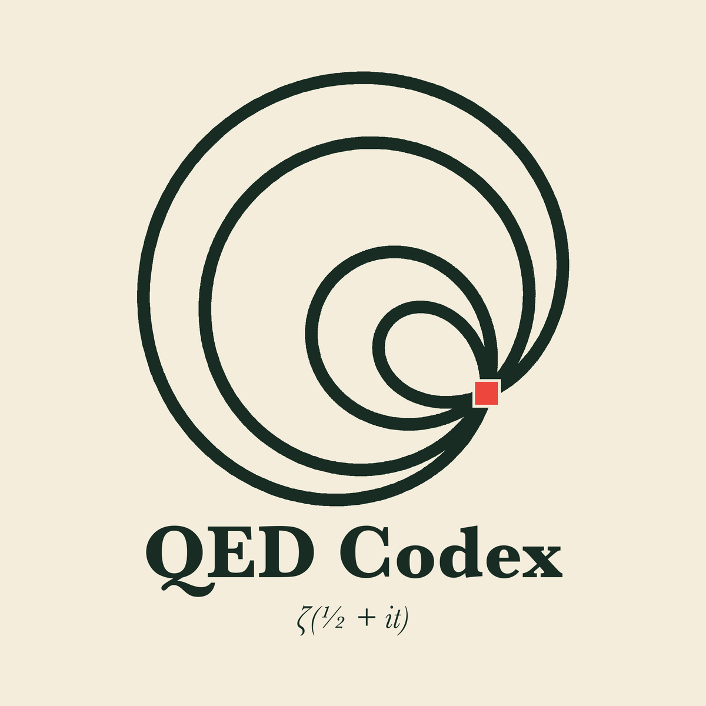

# QED Codex



Site address: to be filled at launch.

Independent project. Not affiliated with any AI vendor.

QED Codex presents natural-language accounts of machine-written proofs. Read human informalizations and AI-generated autoinformalizations side by side. The directory holds the original Riemann Hypothesis proof at `40e56bab` and the readable rewrite at `72fead10`. Search a declaration, read its pinned source, or follow the recorded trail to `riemannHypothesis`. Module pages bring together contributed informalizations, credited outside explanations and evidence of use by five theorems. [Original proof](https://github.com/leanprover-community/riemann-hypothesis/tree/40e56bab026552e089d7afcfeff08d2defb9c005)

Each informalization occupies one row in the `informalizations` table with its `writer`, submitting `author`, `license` and `source_url`. The directory presents outside work absent from that table as a credited link. Andrew O’Desky’s statements appear with his permission and are excluded from the Parquet and SQLite mirrors. [Capture and comparison](reports/permission-statements/README.md)

To contribute, open a module and choose **Add an informalization**. To challenge a fact or interpretation, choose **Flag a problem** and link to the relevant evidence. The most-wanted board lists RH-used project modules by spine rank and cut, and zeta23 modules awaiting an informalization. The unmatched statements page lists catalogue entries awaiting a module link. You can query the underlying SQLite database from the SQL console. [Contributor guide](CONTRIBUTING.md) · [Board and console screenshots](reports/gate-4/report.md#most-wanted-informalizations) · [Module and declaration screenshots](reports/gate-3/report.md)

The default package contains **7,764 files**, including 2,455 HTML pages. The reproduction block below uses `--preview-probe` to add `app.mjs` and `probe.html`, bringing its total to **7,766 files**. The browser can display the sample records before opening SQLite. At idle it fetches the WASM engine and the compressed interior B-tree bundle. Queries read immutable gzip pieces of four 32,768-byte SQLite pages. The browser reuses the interior bundle and SQLite engine through immutable, content-addressed URLs. Modules containing only imported source notes are read from SQLite. For individual page files, pass `--pages-per-piece 1` to `tools/package.py`. [Build manifest](reports/public-tree/manifest.json) · [Database-page browser results](reports/database-source-notes/review.md) · [Outside sources and documentation links](reports/outside-sources/README.md) · [Compiler and schema](reports/compiler/gate-2.md) · [Isolation checks](reports/isolation/report.md) · [Hosted query measurements](reports/hosted/report.md)

Module and declaration permalinks require the source package, such as `/m/?pkg=riemann-hypothesis&p=src%2FMain.lean`. Search engines receive the package-qualified static copies in the production sitemap. Contributions live under `packages/<package>/informalizations/<module-path>/`; each entry records the source revision it describes.

The package includes a plain Markdown guide at `/llms.txt` and an index at `/informalizations.json`. Each entry links its static page and raw Markdown and includes a SHA-256 digest of the file. [Agent contribution guide](AGENTS.md)

## Reproduce the database and local preview

The default package reads source-documentation-only modules from the database. Pass `--no-database-source-docs` to both `tools/package.py` and `tools/verify_directory.py` to build and check the fully static reference.


Run from the ledger root. Canonical builds pin the official SQLite 3.46.1 amalgamation with FTS5 and dbstat. The measured environment used Python 3.14.4, zlib 1.3.1, Node 22.22.1, Chromium 159.0.8154.6 and the npm lockfile. The SQLite WASM engine is 3.54.1. Use the original analysis revision and the checksummed v0.2.1 inputs. The build reads the analysis checkout. The ledger contains the imported informalization, its attribution and original license notice, and identifier links to external explanations.

```bash
export LC_ALL=C
python3 -m venv .venv
.venv/bin/python -m pip install -r requirements.txt
.venv/bin/python tools/sqlite-runtime.py 3.46.1
npm ci
mkdir -p inputs/shore
git clone https://github.com/qed-codex/riemann-hypothesis-rosetta.git inputs/analysis
git -C inputs/analysis checkout --detach d41bfe7e03a311b8340cbfcebbb3c5fc62ff3dd1
release=https://github.com/james-shore/rh-proof-dependencies/releases/download/v0.2.1
curl -fL --retry 3 "$release/decls.csv.gz" -o inputs/shore/decls.csv.gz
curl -fL --retry 3 "$release/constants.csv.gz" -o inputs/shore/constants.csv.gz
(
  export LD_LIBRARY_PATH="$PWD/inputs/sqlite/3.46.1${LD_LIBRARY_PATH:+:$LD_LIBRARY_PATH}"
  .venv/bin/python tools/build.py inputs/analysis inputs/shore --disputes proofs/rh/disputes.json
  .venv/bin/python tools/package.py build/rh.sqlite3 build/preview --preview-probe
  .venv/bin/python tools/verify.py build/rh.sqlite3 build/preview --check-content reports/public-tree/manifest.json > inputs/manifest.json
  .venv/bin/python tools/parquet.py build/rh.sqlite3 inputs/manifest.json build/parquet
  .venv/bin/python tools/verify_directory.py build/rh.sqlite3 build/preview > inputs/directory.json
  .venv/bin/python tools/fixtures.py build/rh.sqlite3 > inputs/fixtures.json
)
npx playwright install --with-deps chromium firefox webkit
WRANGLER_SEND_METRICS=false npx wrangler pages dev build/preview --ip 127.0.0.1 --port 18741 --inspector-port 19841
```

Open `http://127.0.0.1:18741/`. In another terminal, run the browser measurements below. The harness measures HTTP traffic through a local counting proxy and validates every result against native SQLite. The static package contains no backend. Use a fresh output directory for each packaging run.

```bash
node tools/gate3-evidence.mjs http://127.0.0.1:18741 inputs/fixtures.json inputs/gate4-fixture-evidence fixtures
node tools/test-directory.mjs http://127.0.0.1:18741
node tools/test-console.mjs http://127.0.0.1:18741
.venv/bin/python tools/test_informalizations.py
.venv/bin/python tools/time-preview.py build/preview
```

### Before each deployment

Serve the package locally, then run `node tools/sweep.mjs BASE SEED DATABASE --reflow-only` from the repository root. Use the URL of that package, the recorded breadth seed and the SQLite file used to build it. For the local preview above, run

```sh
node tools/sweep.mjs http://127.0.0.1:18741 "$(cat reports/breadth/seed.txt)" build/rh.sqlite3 --reflow-only
```

Deploy after the command exits with zero failures in Chromium, Firefox and WebKit. It checks every packaged HTML page at 440, 390 and 320 CSS pixels.

To refresh the statement ledger before launch, run `LC_ALL=C .venv/bin/python tools/refresh_statements.py` after preparing the pinned inputs above. It saves the official Lean map with its hash and UTC time, joins its names to the pinned project declarations, checks compiled constants for unmatched pages, and verifies the outside destinations. Normal builds replay the committed ledger and receipt. [Refresh and offline replay](reports/package-fixes/report.md#reproduce)

The reproduction uses the frozen dispute snapshot. By default the compiler reads open GitHub issues that a maintainer has labelled `dispute`. A missing, malformed or unknown path is skipped and its issue number and reason are recorded in the build log and manifest. A frozen snapshot with an invalid issue fails validation. To capture a fresh replay input under an authenticated, read-only GitHub session, run `.venv/bin/python tools/disputes.py inputs/open-disputes.json` with `GH_TOKEN` set and pass that file with `--disputes`. [Snapshot](proofs/rh/disputes.json)

The preview build includes a noindex database test page. For production, pass `--production` to `tools/package.py` to read the registered origin from `site-settings.json`. This omits the test page and enables canonical links, social preview images and `/sitemap.xml`. [Page checks](reports/staging-review/report.md)

The runtime installer uses a C compiler on Linux and checks the SHA-256 of the SQLite source archive. The canonical manifest includes the SQLite file hash, static tree hash and ordered logical content of every table. To check a different SQLite layout, rebuild in a separate directory and compare the logical contents. The verifier still checks that every gzip asset inflates to the corresponding bytes in that build.

```bash
.venv/bin/python tools/sqlite-runtime.py 3.53.1
(
  export LD_LIBRARY_PATH="$PWD/inputs/sqlite/3.53.1${LD_LIBRARY_PATH:+:$LD_LIBRARY_PATH}"
  .venv/bin/python tools/build.py inputs/analysis inputs/shore --disputes proofs/rh/disputes.json --comparison-build --out build/compare.sqlite3
  .venv/bin/python tools/package.py build/compare.sqlite3 build/compare-pages --preview-probe
  .venv/bin/python tools/verify.py build/compare.sqlite3 build/compare-pages --check-content reports/public-tree/manifest.json > inputs/comparison-manifest.json
)
```

To replay the ledger import, run `.venv/bin/python tools/seed.py inputs/analysis` and `git diff --exit-code -- proofs/rh packages`. The RowSrc autoinformalization credits `dial481` and names Codex (GPT-6.2 Astra) as its writer. [Pinned informalization](https://github.com/qed-codex/riemann-hypothesis-rosetta/blob/d41bfe7e03a311b8340cbfcebbb3c5fc62ff3dd1/results/phase-2/01-row0b.md)

## Sources and licenses

New text written or generated for QED Codex is CC BY 4.0. Previously published text shows its source licence. Imported text keeps its own licence, shown beside it. Code is MIT.

- Levent Alpöge’s formalization supplies the original source. The module and trace data come from the frozen Rosetta analysis. [Original Lean revision](https://github.com/leanprover-community/riemann-hypothesis/tree/40e56bab026552e089d7afcfeff08d2defb9c005) · [Pinned analysis](https://github.com/qed-codex/riemann-hypothesis-rosetta/tree/d41bfe7e03a311b8340cbfcebbb3c5fc62ff3dd1)
- James Shore’s CC0 v0.2.1 release supplies the declarations and five-theorem kernel masks. Its list of used declarations comes from Andrew Sutherland’s kernel export. The bit values in order are 1, 2, 4, 8 and 16 for the five targets. [Andrew Sutherland’s export](https://math.mit.edu/~drew/grh/) · [James Shore’s release](https://github.com/james-shore/rh-proof-dependencies/releases/tag/v0.2.1) · [Target order](https://github.com/james-shore/rh-proof-dependencies/blob/v0.2.1/data/per-theorem.tsv)
- Andrew O’Desky’s *Statements of the Lean RH project* supplies a map of 2,029 pages. Exact project declarations link 2,005 pages. Compiled constants link seven more, bringing the total to 2,012. Bartosz Naskręcki’s atlas supplies a further 107 module links. [Official Lean map](https://andrewodesky.com/rh/lean-map.tsv) · [Snapshot and match counts](proofs/rh/sources/odesky/counts.json) · [Atlas model](https://github.com/nasqret/riemann-rev/blob/d53b3804bd013df4cf9af3b4087728148c90c9bd/data/model.json)
- Code uses the MIT license. New descriptions use CC BY 4.0. Permission-only work names the writer and source on the site and is excluded from the mirrors. [Code license](LICENSE) · [Informalization license](https://creativecommons.org/licenses/by/4.0/) · [Imported informalization notice](proofs/rh/seed-license.txt)


## zeta23

The directory includes the zeta23 project description and documentation from the pinned Lean files. Its authors describe the repository as an unmaintained research artifact. Each module links to its original source and welcomes an independent description. [Pinned source](https://github.com/anthropics/formal-math/tree/11b6c7e3c927df2658f513b6b68ea7f8929c62c5/zeta23)

To replay the import, download the archive once, then run the register command in a clean output directory. Ordinary builds use the committed inventory, metadata and ledger.

```sh
curl --fail --location https://codeload.github.com/anthropics/formal-math/tar.gz/11b6c7e3c927df2658f513b6b68ea7f8929c62c5 -o inputs/formal-math-11b6c7e.tar.gz
.venv/bin/python tools/import_lean_docs.py packages/zeta23/import.json inputs/formal-math-11b6c7e.tar.gz build/zeta23-replay
diff -r packages/zeta23/informalizations build/zeta23-replay/zeta23/informalizations
cmp packages/zeta23/modules.txt build/zeta23-replay/zeta23/modules.txt
```
